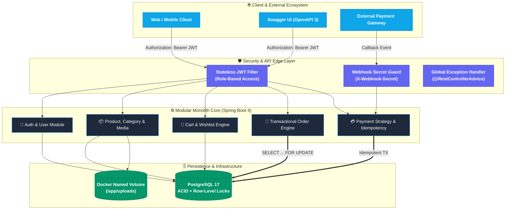
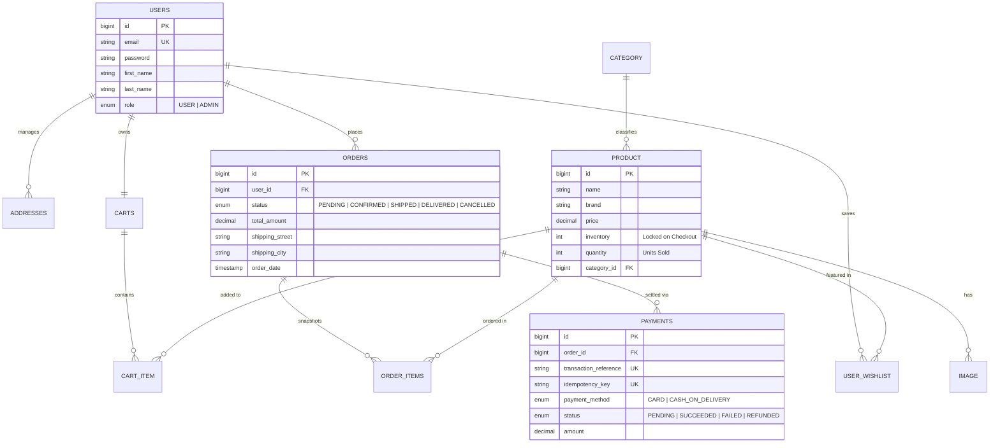

<div align="center">

<!-- Animated Wave Header -->


<!-- Dynamic Typing SVG -->
<a href="https://github.com/AK-Elshamy/cartify">
  
</a>

<br/>

<!-- Tech Stack Badges -->
[](https://openjdk.org/)
[](https://spring.io/projects/spring-boot)
[](https://www.postgresql.org/)
[](https://spring.io/projects/spring-security)
[](https://www.docker.com/)
[](http://localhost:8080/swagger-ui.html)
[](#-automated-test-suite)

</div><br/><br/>

<!-- Quick Navigation Topic Links -->
<p align="center">
  <a href="#-why-cartify-stands-out"><strong>🎯 Overview</strong></a> •
  <a href="#-system-architecture"><strong>🏗️ Architecture</strong></a> •
  <a href="#-database-schema-erd"><strong>🗄️ Database ERD</strong></a> •
  <a href="#-concurrency--payment-flow"><strong>⚡ Payment Flow</strong></a> •
  <a href="#-engineering-decisions--trade-offs"><strong>🧠 Trade-offs</strong></a> •
  <a href="#-one-command-deployment"><strong>🚀 Quick Start</strong></a> •
  <a href="#-api-reference"><strong>📡 API Docs</strong></a> •
  <a href="#-automated-test-suite"><strong>🧪 Tests</strong></a>
</p>

</div>

---

<br/>

> [!IMPORTANT]
> **Production Mindset, Not Just CRUD:** Cartify is architected to solve real-world e-commerce engineering
bottlenecks—preventing **inventory overselling** under concurrent load, eliminating **duplicate charges** via
database-enforced idempotency keys, and automating **stock rollbacks** on failed asynchronous payment webhooks.

---

## 🎯 Why Cartify Stands Out

<table>
  <tr>
    <td width="50%" valign="top">
      <h3>👔 For Recruiters & Hiring Managers</h3>
      <ul>
        <li><b>End-to-End Ownership:</b> Complete lifecycle from database modeling & security to testing, API docs, and containerization.</li>
        <li><b>Zero-Friction Setup:</b> Runs with a single <code>docker compose up</code> command—no local JDK or database setup needed.</li>
        <li><b>Clean Git Workflow:</b> Built incrementally using feature branches, semantic commits, and peer-review-ready PR structure.</li>
        <li><b>Self-Documented API:</b> Interactive Swagger UI with pre-configured JWT Bearer authorization out of the box.</li>
      </ul>
    </td>
    <td width="50%" valign="top">
      <h3>🧠 For Tech Leads & Senior Engineers</h3>
      <ul>
        <li><b>Concurrency Control:</b> JPA <code>PESSIMISTIC_WRITE</code> row-level locks (<code>SELECT ... FOR UPDATE</code>) prevent overselling.</li>
        <li><b>Financial Integrity:</b> Immutable price & address snapshots at checkout + database-enforced payment idempotency.</li>
        <li><b>Extensible Design Patterns:</b> Strategy Pattern for payment gateways (<code>CARD</code>, <code>COD</code>) honoring Open/Closed Principle.</li>
        <li><b>Hardened Runtime:</b> Multi-stage Docker build executing under a dedicated non-root Linux user.</li>
      </ul>
    </td>
  </tr>
</table>

---

## 🏗️ System Architecture

Cartify enforces a clean **Layered Modular Monolith** architecture. Every request passes through stateless JWT
verification and global exception boundaries before hitting transactional domain services.



---

## 🗄️ Database Schema (ERD)

Designed for **3NF data integrity**, **historical immutability** (snapshotting prices and shipping addresses at
checkout), and **unique idempotency constraints**.



---

## ⚡ Concurrency & Payment Flow

### How Cartify Prevents Overselling & Double-Charging

```mermaid
sequenceDiagram
    autonumber
    actor Buyer as 🛍️ Customer
    participant API as ⚙️ Cartify API
    participant DB as 🐘 PostgreSQL 17
    participant PSP as 💳 Payment Gateway

    rect rgb(15, 23, 42)
        Note over Buyer, DB: Phase 1: Pessimistic-Locked Checkout
        Buyer ->> API: POST /api/orders/checkout { addressId }
        API ->> DB: BEGIN TRANSACTION
        API ->> DB: SELECT * FROM product WHERE id IN (...) FOR UPDATE
        DB -->> API: Row Locks Acquired (Concurrent Buyers Queued)
        API ->> DB: Verify Stock -> Deduct Inventory -> Snapshot Address & Prices
        API ->> DB: Save Order (PENDING) & Clear Cart -> COMMIT
        API -->> Buyer: 201 Created { orderId, totalAmount }
    end

    rect rgb(30, 41, 59)
        Note over Buyer, PSP: Phase 2: Idempotent Payment Initiation
        Buyer ->> API: POST /api/payments/initiate { orderId, CARD, idempotencyKey }
        API ->> DB: Lookup idempotencyKey
        alt Key Already Exists
            DB -->> API: Return Existing Payment (Zero Duplicate Charge)
        else New Payment Request
            API ->> DB: Save Payment (PENDING) + Generate TXN Reference
        end
        API -->> Buyer: 201 Created { transactionReference, paymentUrl }
    end

    rect rgb(17, 24, 39)
        Note over PSP, DB: Phase 3: Verified Asynchronous Webhook
        PSP ->> API: POST /api/payments/webhook [Header: X-Webhook-Secret]
        API ->> API: Verify Webhook Secret Signature
        alt Status == SUCCEEDED
            API ->> DB: Payment -> SUCCEEDED | Order -> CONFIRMED
        else Status == FAILED
            API ->> DB: Payment -> FAILED | Order -> CANCELLED | Restore Stock
        end
        API -->> PSP: 200 OK
    end
```



---

## 🧠 Engineering Decisions & Trade-offs

| Architectural Challenge                 | Solution Implemented                                                                         | Engineering Impact                                                                                    |
|:----------------------------------------|:---------------------------------------------------------------------------------------------|:------------------------------------------------------------------------------------------------------|
| **Concurrent Checkout Race Conditions** | JPA `@Lock(LockModeType.PESSIMISTIC_WRITE)`                                                  | Guarantees zero negative inventory even when multiple threads purchase the final unit simultaneously. |
| **Catalog Mutations After Purchase**    | **Order Snapshot Pattern** (copying `unitPrice` & address fields onto `Order` / `OrderItem`) | Prevents admin price edits or user address deletions from corrupting historical financial invoices.   |
| **Adding Future Payment Providers**     | **Strategy Pattern** (`PaymentStrategy` interface + Spring DI map)                           | Adding Apple Pay or PayPal requires zero changes to `PaymentServiceImpl` (**Open/Closed Principle**). |
| **Network Retries & Double Clicks**     | Database `UNIQUE` constraint on `idempotencyKey`                                             | Safely returns the original payment session on duplicate client retries without re-charging.          |
| **ORM $N+1$ Query Degradation**         | `@EntityGraph` + Java `record` DTO Projections                                               | Fetches relational graphs in single `LEFT JOIN` queries and prevents accidental lazy-loading leaks.   |
| **Container Attack Surface**            | **Multi-Stage Dockerfile** + dedicated non-root `spring` user                                | Strips Maven/JDK build tools from production runtime and isolates filesystem permissions.             |

---

## 🚀 One-Command Deployment

Boot the entire production stack (**Spring Boot 4 API + PostgreSQL 17** with healthchecks and persistent volumes) in
seconds:

```bash
# 1. Clone the repository
git clone https://github.com/AK-Elshamy/cartify.git
cd cartify

# 2. Build the multi-stage image and start all containers
docker compose up --build -d

# 3. Check container health status
docker compose ps
```

### 🌐 Live Interactive Endpoints

| Service                           | URL                                     | Notes                                        |
|:----------------------------------|:----------------------------------------|:---------------------------------------------|
| **Swagger UI (Interactive Docs)** | `http://localhost:8080/swagger-ui.html` | Click **Authorize** and paste your JWT token |
| **OpenAPI 3.0 JSON Spec**         | `http://localhost:8080/v3/api-docs`     | Importable into Postman / Bruno              |
| **REST API Base URL**             | `http://localhost:8080/api`             | Ready for frontend integration               |

---

## 📡 API Reference

<details>
<summary><b>🔐 Authentication & Users</b> (Click to expand)</summary>

| Method | Endpoint             | Auth             | Description                                         |
|:-------|:---------------------|:-----------------|:----------------------------------------------------|
| `POST` | `/api/auth/register` | Public           | Register a new customer (`USER` role)               |
| `POST` | `/api/auth/login`    | Public           | Authenticate credentials and issue JWT Bearer token |
| `GET`  | `/api/users/me`      | `USER` / `ADMIN` | Retrieve authenticated user profile                 |

</details>

<details>
<summary><b>📦 Products, Categories & Wishlist</b> (Click to expand)</summary>

| Method | Endpoint                    | Auth    | Description                                                     |
|:-------|:----------------------------|:--------|:----------------------------------------------------------------|
| `GET`  | `/api/products`             | Public  | Paginated & filterable product listing (`page`, `size`, `sort`) |
| `POST` | `/api/products`             | `ADMIN` | Create a new product with initial inventory                     |
| `POST` | `/api/images/upload`        | `ADMIN` | Upload product images to persistent Docker volume               |
| `GET`  | `/api/categories`           | Public  | List all product categories                                     |
| `POST` | `/api/wishlist/{productId}` | `USER`  | Toggle product in personal wishlist                             |

</details>

<details>
<summary><b>🛒 Shopping Cart, Addresses & Orders</b> (Click to expand)</summary>

| Method  | Endpoint                       | Auth    | Description                                        |
|:--------|:-------------------------------|:--------|:---------------------------------------------------|
| `GET`   | `/api/cart`                    | `USER`  | Get active shopping cart and calculated subtotal   |
| `POST`  | `/api/cart/items`              | `USER`  | Add item or update quantity in cart                |
| `POST`  | `/api/addresses`               | `USER`  | Save a shipping address                            |
| `POST`  | `/api/orders/checkout`         | `USER`  | Execute pessimistic-locked checkout & create order |
| `PATCH` | `/api/orders/{orderId}/cancel` | `USER`  | Cancel pending order and restore reserved stock    |
| `PATCH` | `/api/orders/{orderId}/status` | `ADMIN` | Advance order fulfillment lifecycle                |

</details>

<details open>
<summary><b>💳 Payments & Webhooks</b> (Click to expand)</summary>

| Method | Endpoint                        | Auth               | Description                                   |
|:-------|:--------------------------------|:-------------------|:----------------------------------------------|
| `POST` | `/api/payments/initiate`        | `USER`             | Initiate `CARD` or `CASH_ON_DELIVERY` payment |
| `POST` | `/api/payments/webhook`         | `X-Webhook-Secret` | Gateway callback (`SUCCEEDED` / `FAILED`)     |
| `GET`  | `/api/payments/order/{orderId}` | `USER`             | Retrieve payment history for an order         |

**Sample Checkout & Payment Payload:**

```json
// POST /api/payments/initiate
{
  "orderId": 1,
  "paymentMethod": "CARD",
  "idempotencyKey": "checkout-order-1-attempt-1"
}
```

```json
// 201 Created Response
{
  "id": 1,
  "orderId": 1,
  "transactionReference": "TXN-89F2A1C4-91B",
  "paymentMethod": "CARD",
  "status": "PENDING",
  "orderStatus": "PENDING",
  "amount": 1500.00,
  "paymentUrl": "https://checkout.cartify-pay.local/pay/TXN-89F2A1C4-91B",
  "createdAt": "2026-11-21T09:30:00.124510"
}
```

</details>

---

## 🧪 Automated Test Suite

Run the isolated unit test suite powered by **JUnit 5**, **Mockito**, and **AssertJ**:

```bash
./mvnw test
```

* **`OrderServiceImplTest`** — Verifies stock deduction, price/address snapshotting, cart clearing, empty-cart
  rejection, `InsufficientStockException` rollback, and inventory restoration on cancellation.
* **`PaymentServiceImplTest`** — Verifies payment strategy resolution, duplicate `idempotencyKey` short-circuiting,
  invalid webhook secret rejection (`403 Forbidden`), order confirmation on `SUCCEEDED`, and automatic stock rollback on
  `FAILED`.

---

## 📂 Project Structure

```text
cartify/
├── src/
│   ├── main/java/com/elshamy/cartify/
│   │   ├── config/          # Spring Security, OpenAPI 3 & Web MVC configurations
│   │   ├── controller/      # REST controllers with Jakarta Bean Validation
│   │   ├── dtos/            # Immutable Java Record request/response contracts
│   │   ├── exception/       # Centralized @RestControllerAdvice error mapping
│   │   ├── model/           # JPA Entities, Enums & relational mappings
│   │   ├── repository/      # Spring Data JPA repositories & row-level locks
│   │   ├── security/        # Stateless JWT filter, token provider & UserDetails
│   │   └── service/         # Domain business logic & Payment Strategy implementations
│   └── test/java/com/elshamy/cartify/
│       └── service/         # JUnit 5 & Mockito test suites
├── Dockerfile               # Multi-stage Java 25 build with non-root runtime user
├── docker-compose.yml       # Health-checked PostgreSQL 17 + API orchestration
└── pom.xml                  # Maven build & dependency management
```

---

<div align="center">

### 👨‍💻 Architected & Engineered by **Ahmed Elshamy**

[](https://github.com/AK-Elshamy)
[](https://www.linkedin.com/in/a-elshamy)

*⭐ Star this repository if you appreciate clean backend architecture!*


</div>