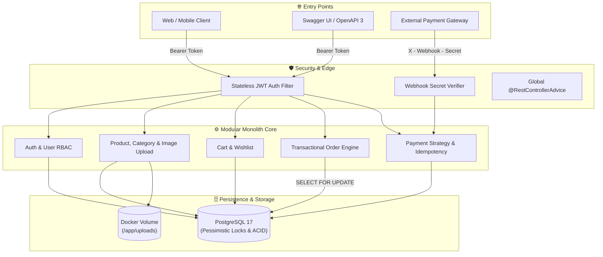
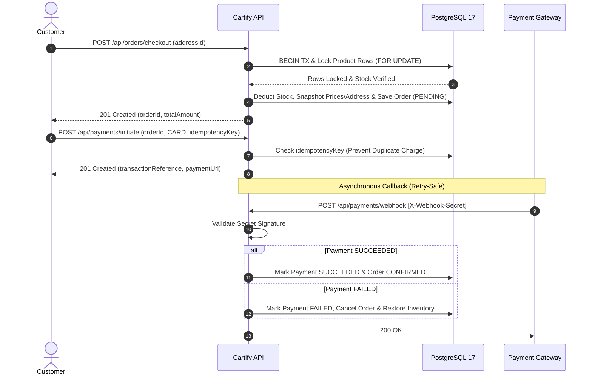

<div align="center">

# 🛒 CARTIFY

### **Enterprise-Grade Modular Monolith E-Commerce Backend**

[](https://openjdk.org/)
[](https://spring.io/projects/spring-boot)
[](https://www.postgresql.org/)
[](https://spring.io/projects/spring-security)
[](https://www.docker.com/)
[](http://localhost:8080/swagger-ui.html)

**Built for high concurrency, financial idempotency, and clean domain-driven modularity.**

[🚀 Quick Start](#-quick-start-one-command) • [🏗️ Architecture](#️-system-architecture) • [⚡ Concurrency & Payments](#-deep-dive-concurrency--payment-engine) • [📡 API Reference](#-api-reference)

</div>

---

## 🎯 Executive Summary (For Recruiters & Hiring Managers)

**Cartify** is a production-ready E-Commerce RESTful API engineered from the ground up to mirror real-world backend
systems. Instead of basic CRUD operations, this system solves **distributed-style backend challenges** including
inventory race conditions, duplicate payment prevention, asynchronous webhook verification, and containerized
zero-downtime readiness.

| Metric / Capability      | Implementation                                                                           |
|:-------------------------|:-----------------------------------------------------------------------------------------|
| **Architecture Style**   | Domain-Driven **Modular Monolith** (10 cohesive business modules)                        |
| **Concurrency Control**  | Database-level **Pessimistic Write Locking** (`SELECT ... FOR UPDATE`)                   |
| **Payment Reliability**  | **Strategy Pattern** + **Idempotency Keys** + **HMAC/Secret-Verified Webhooks**          |
| **Security Posture**     | Stateless **JWT**, Role-Based Access Control (`USER` / `ADMIN`), Non-root Docker runtime |
| **Quality Assurance**    | Automated **JUnit 5 & Mockito** test suite covering critical transactional paths         |
| **Developer Experience** | **One-command Docker Compose** boot + Interactive **Swagger UI**                         |

---

## 🏗️ System Architecture

Cartify follows a **Modular Monolith** architecture where each domain encapsulates its own controller, DTOs, service
contract, repository, and domain rules—making the codebase clean, testable, and ready for future microservice
extraction.



---

## ⚡ Deep Dive: Concurrency & Payment Engine (For Tech Leads)

### 1. Solving the "Overselling" Race Condition

When multiple customers simultaneously checkout the last item in stock, standard read-then-write logic fails. Cartify
enforces **ACID transactions** combined with JPA **Pessimistic Write Locking**
(`@Lock(LockModeType.PESSIMISTIC_WRITE)`), serializing concurrent stock deductions at the PostgreSQL row level.

### 2. Idempotent Checkout & Webhook Sequence Flow



### 3. Key Engineering Trade-offs

| Problem                                  | Chosen Solution                                    | Why This Matters                                                                          |
|:-----------------------------------------|:---------------------------------------------------|:------------------------------------------------------------------------------------------|
| **Adding new payment gateways**          | **Strategy Pattern** (`PaymentStrategy` interface) | Eliminates `if/else` chains; complies with the **Open/Closed Principle**.                 |
| **Product price changes after purchase** | **Order Item & Address Snapshots**                 | Historical invoices stay immutable even if catalog prices or user addresses change later. |
| **Network retries on payment requests**  | **Unique `idempotencyKey` constraint**             | Guarantees a user is never charged twice for the same checkout attempt.                   |
| **$N+1$ query performance bottlenecks**  | **`@EntityGraph` & DTO Projections**               | Fetches relational graphs in single optimized SQL joins without exposing entities.        |

---

## 🛠️ Tech Stack

* **Language & Framework:** Java 25, Spring Boot 4.1.2, Spring Web MVC, Bean Validation
* **Database & ORM:** PostgreSQL 17, Spring Data JPA, Hibernate 7.4 (`PostgreSQLDialect`)
* **Security:** Spring Security, Stateless JWT (`jjwt 0.12.6`), BCrypt Password Hashing, RBAC (`USER`, `ADMIN`)
* **API Documentation:** SpringDoc OpenAPI 3 / Swagger UI (`3.0.0`)
* **Testing:** JUnit 5, Mockito, AssertJ
* **DevOps & Containerization:** Multi-stage `Dockerfile` (non-root user), `docker-compose` with PostgreSQL healthchecks

---

## 🚀 Quick Start (One Command)

Run the entire stack (**Spring Boot API + PostgreSQL 17**) using Docker—no local Java or PostgreSQL setup needed:

```bash
# 1. Clone the repository
git clone https://github.com/AK-Elshamy/cartify.git
cd cartify

# 2. Build and start all services in detached mode
docker compose up --build -d

# 3. Verify running containers
docker compose ps
```

### 🌐 Access Points

* **Interactive Swagger UI:** [http://localhost:8080/swagger-ui.html](http://localhost:8080/swagger-ui.html)
* **OpenAPI JSON Spec:** [http://localhost:8080/v3/api-docs](http://localhost:8080/v3/api-docs)
* **REST API Base URL:** `http://localhost:8080`

> **Tip:** Open Swagger UI, call `POST /api/auth/register` or `POST /api/auth/login`, copy the `token`, click the green
> **Authorize** button at the top right, and test any protected endpoint directly in your browser.

---

## 📡 API Reference & Sample Payloads

<details>
<summary><b>🔐 Authentication & User Profile (Click to expand)</b></summary>

| Method | Endpoint             | Access        | Description                                 |
|:-------|:---------------------|:--------------|:--------------------------------------------|
| `POST` | `/api/auth/register` | Public        | Register a new customer account             |
| `POST` | `/api/auth/login`    | Public        | Authenticate and receive a JWT Bearer token |
| `GET`  | `/api/users/me`      | Authenticated | Retrieve current authenticated user profile |

</details>

<details>
<summary><b>📦 Catalog, Categories, Images & Wishlist (Click to expand)</b></summary>

| Method | Endpoint                    | Access        | Description                                |
|:-------|:----------------------------|:--------------|:-------------------------------------------|
| `GET`  | `/api/products`             | Public        | Paginated & filterable product catalog     |
| `POST` | `/api/products`             | `ADMIN`       | Create a new product                       |
| `POST` | `/api/images/upload`        | `ADMIN`       | Upload product images to persistent volume |
| `GET`  | `/api/categories`           | Public        | Retrieve all product categories            |
| `POST` | `/api/wishlist/{productId}` | Authenticated | Add or remove a product from wishlist      |

</details>

<details>
<summary><b>🛍️ Cart, Addresses & Transactional Orders (Click to expand)</b></summary>

| Method  | Endpoint                       | Access        | Description                                     |
|:--------|:-------------------------------|:--------------|:------------------------------------------------|
| `GET`   | `/api/cart`                    | Authenticated | View active cart items & calculated total       |
| `POST`  | `/api/cart/items`              | Authenticated | Add product or update item quantity             |
| `POST`  | `/api/addresses`               | Authenticated | Add a delivery address                          |
| `POST`  | `/api/orders/checkout`         | Authenticated | Execute transactional checkout with row locking |
| `PATCH` | `/api/orders/{orderId}/cancel` | Authenticated | Cancel pending order & restore inventory        |
| `PATCH` | `/api/orders/{orderId}/status` | `ADMIN`       | Transition order fulfillment status             |

</details>

<details open>
<summary><b>💳 Idempotent Payments & Webhooks (Click to expand)</b></summary>

| Method | Endpoint                        | Access             | Description                                     |
|:-------|:--------------------------------|:-------------------|:------------------------------------------------|
| `POST` | `/api/payments/initiate`        | Authenticated      | Initiate payment (`CARD` or `CASH_ON_DELIVERY`) |
| `POST` | `/api/payments/webhook`         | `X-Webhook-Secret` | Process payment gateway status callback         |
| `GET`  | `/api/payments/order/{orderId}` | Authenticated      | List all payment attempts for an order          |

**Sample Payment Initiation Request (`POST /api/payments/initiate`):**

```json
{
  "orderId": 3,
  "paymentMethod": "CARD",
  "idempotencyKey": "pay-order-3-attempt-1"
}
```

**Sample Response (`201 Created`):**

```json
{
  "id": 1,
  "orderId": 3,
  "transactionReference": "TXN-758EEC0A-D77",
  "paymentMethod": "CARD",
  "status": "PENDING",
  "orderStatus": "PENDING",
  "amount": 77850.00,
  "paymentUrl": "https://checkout.cartify-pay.local/pay/TXN-758EEC0A-D77",
  "createdAt": "2026-11-21T07:11:32.665343"
}
```

</details>

---

## 🧪 Automated Testing

The unit test suite isolates business logic using **JUnit 5** and **Mockito** to verify edge cases without database
overhead:

```bash
./mvnw test
```

* **`OrderServiceImplTest`:** Validates stock deduction, price/address snapshotting, cart clearing, empty-cart
  rejection, `InsufficientStockException` rollback, and inventory restoration upon order cancellation.
* **`PaymentServiceImplTest`:** Validates Strategy selection, duplicate `idempotencyKey` short-circuiting, invalid
  webhook signature rejection (`403 Forbidden`), order confirmation on `SUCCEEDED`, and automatic stock restoration on
  `FAILED`.

---

## 📂 Project Structure

```text
cartify/
├── src/
│   ├── main/java/com/elshamy/cartify/
│   │   ├── config/          # Security, OpenAPI/Swagger & Web MVC configs
│   │   ├── controller/      # Versioned REST controllers with Bean Validation
│   │   ├── dtos/            # Immutable Java Record request/response DTOs
│   │   ├── exception/       # Centralized @RestControllerAdvice error handling
│   │   ├── model/           # JPA Entities, Enums & relational mappings
│   │   ├── repository/      # Spring Data JPA repositories & pessimistic locks
│   │   ├── security/        # JWT filter, token service & UserDetailsService
│   │   └── service/         # Core domain services & Payment Strategy beans
│   └── test/java/com/elshamy/cartify/
│       └── service/         # JUnit 5 & Mockito unit test suites
├── Dockerfile               # Multi-stage Java 25 build with non-root user
└── docker-compose.yml       # Health-checked PostgreSQL 17 + API orchestration
```

---

<div align="center">

### 👨‍💻 Engineered by **Ahmed Elshamy**

[](https://github.com/AK-Elshamy)

*If you found this architecture useful, feel free to give the repository a ⭐!*

</div>